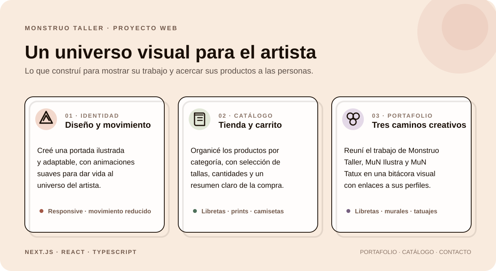
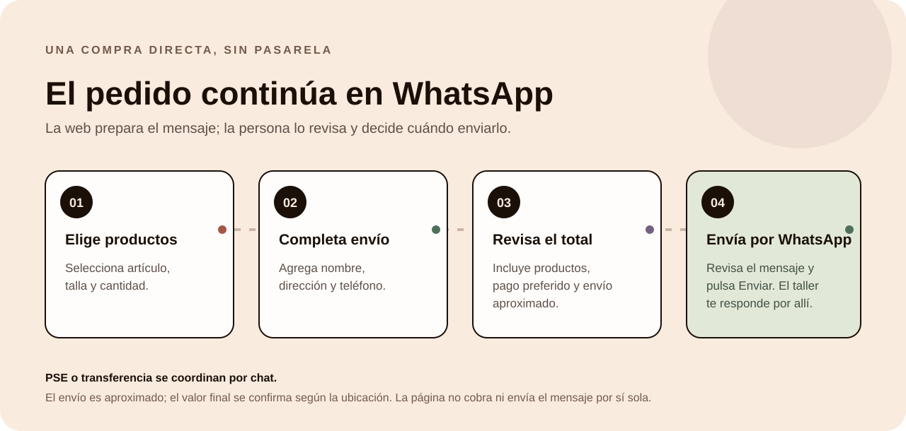

# Monstruo Taller

Sitio web visual de Monstruo Taller, un proyecto artístico independiente. Reúne sus libretas y otros productos, una bitácora de eventos y las distintas prácticas que nacen de su universo creativo: ilustración, murales y tatuajes.

El sitio permite armar un pedido y coordinarlo directamente por WhatsApp. No procesa pagos en línea ni confirma compras automáticamente.

## Lo que hice



- Diseñé una portada ilustrada y adaptable, con animaciones suaves.
- Organicé los productos en un catálogo con selección de tallas, cantidades y carrito.
- Reuní Monstruo Taller, MuN Ilustra y MuN Tatux en un mismo portafolio.
- Preparé el checkout para coordinar los pedidos directamente por WhatsApp.

## Secciones

- **Inicio (`/`)**: presentación ilustrada, productos destacados y contacto con el taller.
- **Tienda (`/tienda`)**: catálogo con filtros por categoría, selección de productos y tallas, y carrito.
- **Eventos (`/eventos`)**: galería visual enlazada a publicaciones de Instagram.
- **Nuestro universo (`/universo`)**: portafolio de Monstruo Taller, MuN Ilustra y MuN Tatux.
- **Checkout (`/checkout`)**: datos de envío, resumen de la compra y preparación del pedido para WhatsApp.

## Cómo funciona el pedido



1. La persona agrega productos al carrito y completa sus datos de envío.
2. Elige PSE o transferencia como método de pago preferido.
3. El checkout abre WhatsApp con un resumen del pedido, listo para revisar y enviar.
4. Monstruo Taller revisa el mensaje, confirma los detalles y coordina el pago por ese medio.

El envío aparece como un valor aproximado de **$10.000 COP**. El monto final se confirma por WhatsApp según la ubicación. La página no cobra ni envía el mensaje automáticamente: la persona debe pulsar **Enviar** en WhatsApp.

## Tecnologías

- Next.js con App Router
- React y TypeScript
- CSS Modules y CSS global
- Lucide React para iconos

## Ejecutar localmente

Necesitas Node.js y npm instalados.

```bash
git clone https://github.com/LinaR3/monstruo-taller.git
cd monstruo-taller
npm ci
npm run dev
```

Abre [http://localhost:3000](http://localhost:3000) en el navegador.

## Comandos disponibles

| Comando | Uso |
| --- | --- |
| `npm run dev` | Inicia el servidor de desarrollo. |
| `npm run build` | Genera la versión de producción. |
| `npm start` | Sirve la versión de producción después de compilarla. |
| `npm run lint` | Ejecuta ESLint. |

## Actualizar el contenido

- **Productos, precios, categorías y tallas:** `src/lib/products.ts`.
- **Fotos de productos:** `public/products/`.
- **Publicaciones de eventos:** `src/app/eventos/page.tsx`; sus imágenes locales están en `public/eventos/` y `public/universo/`.
- **Textos y galerías de los perfiles artísticos:** `src/app/universo/page.tsx`.
- **Estilos:** los archivos `*.module.css` junto a cada página o componente, y `src/app/globals.css` para estilos globales.
